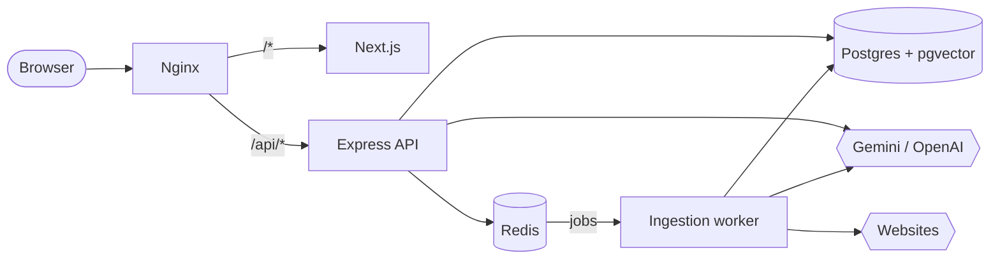
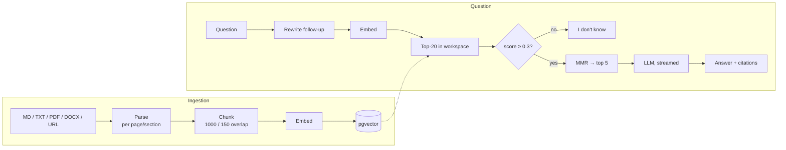

# AskDocs

**Chat with your own documents, with sources.** Upload Markdown, text, PDF or Word files, or point it at a website, then ask questions. Answers stream in token by token, come **only** from your data, and every sentence links to the exact file and page it came from. If your documents don't contain the answer, it says so.

Think Chatbase + Perplexity, built from scratch as a production-style RAG system: multi-tenant, background ingestion, evaluation, tests, CI, and a one-command Docker deployment.

| | |
| --- | --- |
| **Backend** | Node.js 24, Express 5, TypeScript, Zod, Pino |
| **AI / RAG** | Local models via Ollama (`qwen2.5:3b` + `nomic-embed-text`), Google Gemini (free tier) or OpenAI, behind one provider interface; LangChain for splitting, OpenAI wrappers and MMR |
| **Data** | PostgreSQL 17 + pgvector (HNSW), Prisma 7 (+ raw SQL for vectors) |
| **Jobs / limits** | Redis, BullMQ, express-rate-limit |
| **Frontend** | Next.js 16 (Pages Router), React 19, TanStack Query, Zustand, Tailwind CSS 4 |
| **Infra** | Docker Compose, Nginx, AWS EC2, GitHub Actions |

## Features

- **Workspaces as tenants.** Every query is scoped to a workspace, including the vector search, and integration tests prove it.
- **Sources**: Markdown, TXT, PDF and DOCX upload (type checked by content, 10 MB; Markdown and TXT preferred: smallest and fastest to index), plus website crawling (SSRF-safe, robots.txt, depth and page limits).
- **Background ingestion** with live status: `pending → processing → ready | failed`, with retries.
- **Retrieval**: tenant-filtered HNSW similarity search → relevance threshold → MMR re-ranking.
- **Chat**: SSE streaming, conversation memory, follow-up rewriting, a Stop button, and clickable citations that open the PDF at the cited page.
- **"I don't know"** instead of guessing, plus prompt-injection defences for untrusted documents.
- **Cost control**: per-workspace token usage and a monthly quota, abuse caps, and Redis rate limits.
- **Evaluation**: `pnpm eval` measures hit rate@k and MRR on a labelled question set.

## Architecture



### RAG pipeline



The full design is in **[docs/ARCHITECTURE.md](docs/ARCHITECTURE.md)**: schema, HNSW vs IVFFlat, API list, trade-offs, and security.

## Quick start (Docker, one command)

Prerequisites: Docker with Compose v2.

```bash
cp backend/.env.example backend/.env
# Edit backend/.env:
#   JWT_SECRET      -> output of: openssl rand -hex 32
#   GEMINI_API_KEY  -> a free key from https://aistudio.google.com  (LLM_PROVIDER=gemini)
#                      or LLM_PROVIDER=openai + OPENAI_API_KEY, or LLM_PROVIDER=fake to try it offline

docker compose up --build
```

Open **http://localhost**. If port 80 is taken: `HTTP_PORT=8088 docker compose up --build`.

Compose starts:
- Postgres + pgvector;
- Redis;
- a one-shot migration job;
- the API;
- the ingestion worker;
- the Next.js app;
- Nginx.

## Local development

**Full step-by-step guide, with expected output and troubleshooting: [docs/GETTING_STARTED.md](docs/GETTING_STARTED.md).** Short version:

```bash
docker compose up -d postgres redis         # data services only (Postgres on :5433, Redis on :6379)

cd backend
cp .env.example .env                        # set JWT_SECRET; LLM_PROVIDER=fake works without a key
pnpm install
pnpm db:deploy                              # apply migrations
pnpm dev                                    # API on :8080
pnpm dev:worker                             # in a second terminal: ingestion worker

cd ../frontend
cp .env.example .env.local                  # NEXT_PUBLIC_API_URL=http://localhost:8080/api
pnpm install
pnpm dev                                    # http://localhost:3000
```

> Don't run a local worker *and* the Docker worker at the same time against the same Redis. Whichever grabs a job first must be able to read the uploaded file.

## Testing, quality, evaluation

```bash
cd backend
pnpm test             # unit + integration (needs: docker compose up -d postgres redis)
pnpm test:unit        # unit only, no services needed
pnpm test:coverage
pnpm lint && pnpm typecheck

pnpm eval             # retrieval quality: hit rate@1, hit rate@k, MRR, no-answer accuracy
                      # use a real provider (gemini/openai) for meaningful numbers

cd ../frontend
pnpm lint && pnpm typecheck && pnpm test && pnpm build
```

Tests use a separate `askdocs_test` database, Redis DB 1, and the offline fake LLM, so they're free and deterministic. CI ([.github/workflows/ci.yml](.github/workflows/ci.yml)) runs all of the above on every push and PR, against real Postgres and Redis service containers.

## Design trade-offs (summary)

| Decision | Choice | Why / alternative |
| --- | --- | --- |
| Chunk size | 1000 chars, 150 overlap, split per page | Precise vectors with enough context; overlap protects boundary sentences. Tune with `pnpm eval`. |
| Embedding model | `text-embedding-3-small`, 1536 dims | Cheap and good. `-large` is better but ~6.5× the cost. Switching models means re-embedding everything. |
| Vector index | HNSW (`m=16`, `ef_construction=64`) | No training step, good with constant inserts. IVFFlat needs data first and degrades as data drifts. |
| Top-k | 20 candidates → 5 to the LLM | Room for re-ranking; small, focused, cheap prompts. |
| Re-ranking | MMR, λ = 0.7 | Removes near-duplicates for free. Next step: a cross-encoder when eval shows recall@20 ≫ recall@5. |
| No-answer | Score threshold 0.3 + prompt rule | Skips the LLM entirely for irrelevant questions: cheaper, and it can't hallucinate. |
| Vector store | pgvector in the main Postgres | One DB, transactions, tenant filter in SQL. Dedicated vector DBs pay off at far larger scale. |
| Cost control | Usage per call, monthly quota, caps, rate limits | Predictable spend per tenant; abuse can't multiply the quota. |

## Documentation

- **[docs/GETTING_STARTED.md](docs/GETTING_STARTED.md)**: run it locally, step by step (Docker → backend → frontend).
- **[docs/ARCHITECTURE.md](docs/ARCHITECTURE.md)**: design, schema, API, trade-offs, security.
- **[docs/DEPLOYMENT.md](docs/DEPLOYMENT.md)**: AWS EC2 + HTTPS deployment guide.
- **[backend/src/prompts/README.md](backend/src/prompts/README.md)**: prompt versioning.
- **[frontend/README.md](frontend/README.md)**: frontend structure, and how streaming and citations work in the UI.

## Project structure

```text
askdocs/
├── backend/       Express API + ingestion worker (src/), Prisma schema & migrations, tests, eval
├── frontend/      Next.js app
├── nginx/         reverse proxy config
├── docker/        Postgres init script (creates the test database)
├── docs/          architecture, build phases, deployment
└── docker-compose.yml
```
